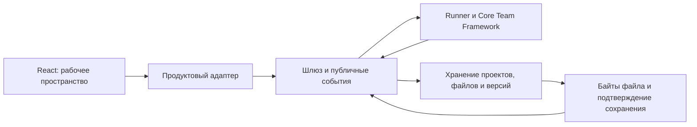

# CoreTeams Product Web: логика сервиса и задачи реализации

**Дата:** 11 ноября 2026 года. **Статус:** продуктовая спецификация нового пути и план технической реализации. Интерфейс в `web-product/prototypes/2026-11-11/` — локальный макет. Работоспособный демонстрационный стенд с полным сценарием существует отдельно; наличие стенда не означает, что именно этот интерфейс уже подключён к нему.

## 1. Назначение и два пользовательских пути

CoreTeams помогает принять обоснованное решение по продукту или проверить решение перед реализацией. Общий путь: сформулировать задачу → ответить на уточняющие вопросы в рабочем пространстве → проверить состав команды и план → получить единый результат → открыть файл, скачать его или уточнить условия для новой версии.

| Роль в каждом новом проекте | Зачем приходит | Ожидаемый результат |
| --- | --- | --- |
| **Владелец решения** | Инициатор или руководитель выбирает направление и обосновывает решение | Варианты, основания и допущения, риски, карта гипотез, план проверки и первый шаг |
| **Ответственный за реализацию** | Исполнитель проверяет техническое решение при ограниченной экспертизе | Проверяемые требования, зависимости, риски, минимальный тест; дополнительно по выбору — черновик повторно применимого скилла |

Роль выбирается яркой кнопкой **для каждого нового проекта**. Отдельного шага «выбрать путь» нет. Сначала нужна только суть задачи, привязанная к продукту и конкретному решению. Сроки, бюджет, материалы и другие условия собираются в диалоге.

## 2. Правила пользовательского сценария

1. Гость сразу видит рабочее пространство и может пройти ознакомительный локальный сценарий. Вход предлагается при сохранении в аккаунте. Локальный черновик сохраняется только в данном браузере; слово «сохранено на сервере» до подтверждения сервера запрещено. Это обновляет прежнее правило эпика 2.5, где гость не создавал проект: серверное создание проекта остаётся действием авторизованного пользователя.
2. После выбора роли фасилитатор задаёт вопросы **по одному в диалоге**, принимает свободный ответ, «Пока не знаю» и прикреплённые материалы. Он использует уже введённые сведения и не повторяет срок или ограничение без причины. Если ответа недостаточно, задаёт следующий уточняющий вопрос в том же сеансе работы. В локальном макете вопросы идут по сценарию; полноценное поведение требует исполнителя и публичных событий.
3. Предлагаются роли, их ответственность и этапы. Пользователь принимает или меняет доступные роли и правит план, может вернуться к вопросам. Запрос новой роли визуально добавляет её в план; **в сервисе** она становится исполняющей ролью только после проверки реестра и доступности. Неизвестная роль не изображается работающим агентом.
4. Кнопка «Согласовать план и продолжить» запускает дальнейшую работу; «Вернуться» сохраняет введённый контекст. Экран команды отображает понятную схему участия и передачи выводов. Подсветка настоящей работы опирается только на подтверждённые события шлюза. Если это демонстрация плана, интерфейс прямо так и говорит.
5. Один результат содержит четыре общих блока: **«Что уже решено», «Что изменилось», «Что нужно от вас», «Основания и допущения»**. Карта гипотез, план проверки и первый шаг — разделы **внутри результата**, а не отдельные версии.
6. Версия — неизменяемый снимок результата с номером, датой, изменениями и признаком «текущая / предыдущая». Открытие версии происходит отдельным окном по действию «Посмотреть версию». Пользователь выбирает формат файла и скачивает его. Результат предлагает следующий шаг и продолжает разговор; изменение условий создаёт новую версию, предыдущая доступна.
7. Для ответственного за реализацию доступен выбор «Документ / Создать скилл». Скилл формируется как архив с `SKILL.md`, шаблоном результата, примером входа, чек-листом и отчётом; статус до пробного запуска — «Черновик». Для первого выпуска он скачивается и запускается в совместимой агентной среде. Личная библиотека и интеграция с GitHub — следующий этап после проверки этой основы.
8. Список проектов показывает не больше **пяти активных проектов** в демо. Удаление переводит проект в корзину с возможностью восстановления; удалённый проект не занимает активное место. Окончательное удаление и срок корзины требуют отдельной серверной политики.
9. Лимит демо означает право запустить **следующую** работу, а не цену. Число «180» и рублёвая цена не утверждены. При исчерпании лимита уже подтверждённые результаты остаются доступными для просмотра и скачивания. Реальное списание нельзя имитировать таймером или локальным числом.

## 3. Сущности и данные, которые сохраняются

| Сущность | Обязательные данные и инвариант |
| --- | --- |
| Аккаунт и доступ | Пользователь, согласие с утверждённым соглашением, сессия, права на каждый проект. Гостевой локальный черновик связывается с аккаунтом только после явного сохранения. |
| Проект | Владелец, выбранная роль, задача, контекст и ограничения, материалы, согласованный план, история действий, состояние корзины. Лимит проверяет сервер. |
| Запуск работы (`Run`) | Один непрерывный проход задача → вопрос → ответ → план → результат с одним идентификатором. Ожидание ответа не завершает запуск. После завершения изменение условий начинает **новый** запуск с явной связью с предыдущим результатом. |
| Вопрос и ответ | Идентификатор вопроса, варианты и режим выбора, ответ, время, принадлежность конкретному запуску. Повторная отправка защищена ключом идемпотентности. |
| Команда и план | Проверенные идентификаторы ролей, ответственность, этапы и их порядок, пользовательские изменения и согласование. |
| Материал | Байты файла, тип, размер, контрольная сумма, статус безопасного приёма и обработки; метаданные сами по себе не означают прочтения файла. |
| Версия результата | Номер в пределах документа, дата, причина изменения, исходный запуск, неизменяемое содержание и перечень файлов. Старая версия не переписывается. |
| Артефакт | Скачиваемые байты выбранного формата или архив скилла, связь с точной версией, тип, размер и контрольная сумма. |
| Подтверждение сохранения (`Receipt`) | Серверный идентификатор, точные версия и артефакт, время подтверждения. Показывается только после успешной записи байтов и метаданных. |
| Лимит демо | Разрешение на следующий запуск и измеренный остаток; неизвестное значение отображается как неизвестное. Не подменяет расчёт стоимости. |

Состояния запуска должны быть согласованы между шлюзом и интерфейсом: очередь, работа, ожидание ответа, проверка результата, завершение, ошибка и неизвестный исход. Завершённый запуск нельзя «возобновлять» ответом. При обрыве связи интерфейс запрашивает текущее состояние по тому же идентификатору, а не создаёт новый запуск вслепую.

## 4. Границы системы

- Интерфейс не вызывает исполнитель напрямую. Адаптер сопоставляет пользовательские действия и состояния с единым контрактом шлюза. Состав команды валидируется по реестру Core Team Framework.
- Шлюз управляет жизненным циклом запуска, вопросом и ответом **в том же запуске**, порядком публичных событий, восстановлением после разрыва, проверкой прав и идемпотентностью.
- Исполнитель создаёт проверяемые события и содержимое результата. Внутренние инструкции, сырые сообщения ролей и технические логи не попадают в пользовательский поток.
- Хранилище отдельно принимает реальные байты исходных материалов и артефактов. Статус «сохранено» выдаётся лишь после подтверждения записи; ссылка на файл ведёт к конкретной версии. Экспорт в другой формат выполняется из подтверждённого содержимого с единым шаблоном оформления.
- Для презентации, Word-документа, PDF и Markdown нужны согласованные шаблоны структуры, типографики и метаданных. Таблицы XLSX есть в локальном макете; серверную поддержку включать после проверки востребованного сценария и качества выгрузки.

Черновой контракт React B описан в `web-product/docs/ctf-v2-contract.md`. Предложенные там адреса запросов — **не утверждённый действующий протокол**. Перед реализацией нужно сопоставить его с текущим шлюзом, исполнителем и хранением и зафиксировать одну схему ответов, ошибок и событий.

## 5. Технические задачи и порядок выполнения

| Приоритет | Задача | Критерий готовности |
| --- | --- | --- |
| 0 | Выбрать интеграционную базу и единый контракт интерфейс ↔ адаптер ↔ шлюз ↔ исполнитель ↔ хранение | Один перечень операций, состояний и событий; вопросы не закрывают запуск; существующий стенд и React B не имеют несовместимых схем. |
| 0 | Реализовать вход, согласие и серверные проекты | Гость проходит ознакомление без аккаунта; после регистрации проект сохраняется под владельцем; чужие проекты недоступны; лимит пяти активных проектов проверяется сервером. |
| 0 | Реализовать загрузку и безопасный приём материалов | Сервер получает байты, сверяет размер и контрольную сумму, проверяет тип и возвращает честный статус приёма/обработки. Ошибка не выглядит как «файл проанализирован». |
| 0 | Реализовать непрерывный жизненный цикл запуска | Вопрос, ответ и продолжение имеют один `runId`; после перезагрузки восстанавливаются состояние и история; повтор команды не создаёт дубль; после завершения новая версия создаётся новым запуском со связью. |
| 0 | Реализовать версионное хранение и подтверждение | Неизменяемые версии и байты, отдельное подтверждение записи, повторное открытие на другом устройстве, скачивание именно выбранной версии, просмотр старой версии после исчерпания лимита. |
| 0 | Подключить React B через адаптер и публичные события | Две роли, вопросы по одному, редактирование плана и команды, статус ожидания, доказанная анимация работы, безопасные ошибки; нет ложных утверждений о запуске агентов и сохранении. |
| 0 | Провести технический сквозной проход | Задача → вопрос → ответ в том же запуске → план → реальный файл → изменение условия → новая версия → повторное открытие и скачивание; отдельные проверки таймаута, повтора, чужого доступа и отсутствующих байтов. |
| 1 | Сформировать единый результат и шаблоны выдачи | Четыре обязательных блока и вложенная карта гипотез; PDF, DOCX, PPTX, MD открываются и скачиваются с одинаковыми заголовками, версией и источниками. |
| 1 | Сформировать скилл для технической роли | Архив содержит `SKILL.md`, шаблон, пример, чек-лист и отчёт; валидируется структура; статус меняется после реального пробного запуска, а не при скачивании. |
| 1 | Довести мобильный интерфейс и доступность | На 320 и 390 px нет горизонтального переполнения содержимого, ввод и действия доступны с клавиатуры и пальцем; документы открываются отдельно. |
| 1 | Добавить наблюдаемость и замеры демо | Логируются переходы и ошибки без содержимого задач; измеряется фактическое потребление; число кредитов определяется после замера и продуктового решения. |
| 2 | Личная библиотека скиллов и интеграция с GitHub | Отдельный контракт владения, версий, прав и публикации; включать после проверки скачиваемого пакета и его пробного запуска. |

## 6. Приёмка релиза и пользовательская проверка

Техническая проверка предшествует пользовательской. Она включает обе роли, узкий и широкий экраны, обновление страницы на каждом состоянии, отказ сети, повтор ответа, недоступную роль, неуспешное сохранение, скачивание разных форматов, корзину и восстановление. Демо-анимация не считается доказательством работы команды: проверяются публичные события и соответствующие им артефакты.

После технической готовности коридорное тестирование проверяет, понимает ли человек роль, следующий вопрос, что именно сделали участники команды, статус сохранения, разницу версий и доступность скачивания после лимита. Для технической роли отдельно проверяется, может ли человек открыть `SKILL.md`, объяснить назначение архива и выполнить пробный запуск в совместимой среде.

**Текущий результат этой ветки:** локальный React-прототип и автономный HTML, четыре автоматические проверки модели, проверка типов, сборка и ручной проход на 390/320 px. Реальные аккаунты, хранение, исполнитель, анализ файлов и серверный лимит в эту ветку не добавлены.
